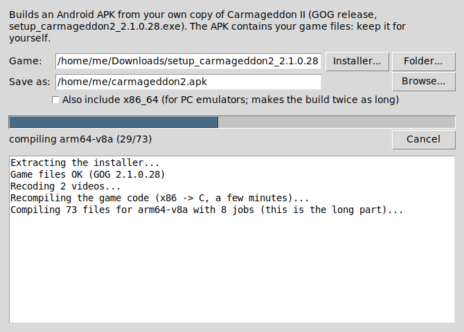

# Carmageddon 2 Android port

A static recompilation of **Carmageddon II: Carpocalypse Now** (the Windows 3dfx/Glide version) into
portable C, with a small reimplementation of the Windows, Glide, DirectSound and DirectInput APIs on top
of SDL2 and OpenGL ES 3. It runs on **Android** (arm64, x86_64) and **Linux**.

> **Bring your own game files.** This repository contains **no game code or data**. The build script
> takes **your own copy** of the game, recompiles it and packs it into an APK on your machine. It has been
> made and tested with the **GOG release** (`setup_carmageddon2_2.1.0.28.exe`); other versions will not
> work, because the recompiled code, hooks and patches are specific to that build (the script checks).
> The APK you build contains your game files: keep it for yourself, don't distribute it.

## Building the APK

### The easy way: the APK builder (Windows, Linux, macOS)

Download the builder for your computer from the [releases](../../releases) page. Builds are available for
**Windows x64**, **Linux x64** and **macOS** (Apple Silicon `arm64` and Intel `x64`), in two editions:

| download | |
|---|---|
| `…-full` | includes everything, works offline |
| `…-light` | smaller; downloads the Zig C compiler (pinned version, checksum verified) the first time |

Nothing else needs to be installed: no Python, no Android SDK, no Java.

1. Unpack it and start `carma2-apk-builder`.
2. Choose your **GOG installer** (`setup_carmageddon2_2.1.0.28.exe`) or the folder where the game is installed.
3. Press **Build APK**.



The first build takes roughly 10–40 minutes, depending on the computer: the game's code is recompiled to C
(about 9,000 functions, ~170 MB of C) and compiled for Android. Later builds reuse that work.
Tick *x86_64* only if you want to run it in a PC Android emulator.

Command line (same program, with arguments):

```sh
carma2-apk-builder setup_carmageddon2_2.1.0.28.exe -o carmageddon2.apk [--abi arm64-v8a,x86_64] [--jobs N]
```

The builder creates a personal signing key the first time (in your user config folder,
`carma2-apk-builder/signing-key.txt`). Keep it: APKs signed with the same key install as updates and keep
your saves.

On macOS the program is not notarised; if it is refused, run
`xattr -dr com.apple.quarantine carma2-apk-builder` once.

**Install** the APK by copying it to the phone and opening it, or with `adb install -r carmageddon2.apk`.
On first launch the app unpacks the game data (~300 MB) to its private storage; later launches start immediately.

### From source

```sh
./build.sh /path/to/setup_carmageddon2_2.1.0.28.exe          # -> dist/carmageddon2.apk
./build.sh /path/to/setup_carmageddon2_2.1.0.28.exe desktop  # -> ./carma2 (Linux)
```

`apk` needs only `python3` (with `venv`): it runs the builder from source. The runtime template APK is built
with Gradle if `ANDROID_HOME` points at an Android SDK (NDK 27.2.12479018, CMake 3.22.1, JDK 17), otherwise
it is downloaded from the latest release. `desktop` needs `innoextract`, `clang`, `make` and the SDL2 and
GLES3 development packages; run it with `./carma2 game/app save` (fullscreen;
`C2_WIN=1280x720 ./carma2 ...` for a window).

Both check that `CARMA2_HW.EXE` and `3dfx_win.bdd` are the tested GOG files (SHA-256).

## Enhancements over the original

* **Native on Android and Linux**: the game's x86 code is recompiled ahead of time to C; nothing is
  emulated at run time.
* **Widescreen (Hor+)**: races fill the whole screen at its native aspect ratio (e.g. 20:9). The camera
  shows more to the sides instead of stretching or cropping; the sky is rebuilt by the game for the
  wider view. The HUD stays centred, the head-up map sits in the bottom-right corner of the screen.
  Menus and videos are shown in 4:3.
* **High resolution**: the game renders at 640×480 originally; here the 3D scene is rendered at a multiple
  of it to match the screen (e.g. 2136×960 on a 1080p-class phone).
* **Frame-rate independent game logic**: the original counts every frame as at least 10 ms, so above
  100 fps physics, AI and the race timer run too fast (1.2× at 120 fps, 2.4× at 240). This is patched
  (`tools/patches.txt`), so the game plays the same at any frame rate.
* **Selectable frame rate cap** (30 / 60 / 120 / unlimited), see below.
* **Videos recoded** to a simple lossless format and played by a built-in player: every frame is decoded
  (the original Smacker player could skip frames on slow devices and corrupt the picture) and the picture
  stays in sync with the soundtrack.
* **CD music** is played from the GOG release's Ogg tracks.
* **Game controllers** (Android and desktop) and **touch controls** (Android) in a style matching the race HUD,
  with the in-race upgrade buying on a fan-out button; the touch controls hide while a controller is in use.
* **Mobile GPU friendly renderer**: draws are batched and submitted together, with a state cache and a
  shader variant without `discard`, so tile-based phone GPUs don't stall (a Pixel 10 Pro XL runs races
  at 120+ fps unlocked).
* **Crash-safe files**: files the game writes (texture caches, options, saves) are written to a temporary
  name and renamed when complete, so an app killed by Android never leaves a truncated file behind.

## Frame rate options

| setting | behaviour |
|---|---|
| **30** | 30 fps, lowest power use |
| **60** (default) | 60 fps; on a 120 Hz screen every second refresh, so pacing stays smooth |
| **120** | 120 fps on a 120 Hz screen |
| **unlimited** | no cap, vsync off (highest power use) |

The cap is matched to the display: the app picks a vsync interval that divides the screen's refresh rate
(on a 120 Hz screen: 30 → every 4th refresh, 60 → every 2nd, 120 → every refresh) and keeps a software
limiter as a backstop. Thanks to the frame-time patch the game behaves the same with every setting.

**How to change it**

* **Android**: during a race tap the screen with **three fingers** to show the performance readout, then
  **tap the readout** to step through 30 → 60 → 120 → unlimited. Three fingers again hides it.
* **Desktop**: press **F9** to step through the caps (`C2_PERF=1` shows the readout).

The choice is saved (`fpscap` in `carma2.cfg` in the app's save folder).

**Performance readout**: `FPS 60  CAP 60  GAME 6.4  GL 1.0  SWAP 0.7` — frames per second, the cap, and
milliseconds per frame spent in the game's own (recompiled) code, in submitting graphics, and waiting
for the GPU / vsync.

## Controls

**Touch** (shown during races; in menus the screen works as a mouse):

| where | button |
|---|---|
| left, bottom | steer left / right |
| left, middle | repair (spanner), recover (flip arrow) |
| right, bottom | accelerate (green pedal), brake / reverse (red pedal), use power-up (burst) between them |
| right, middle | handbrake (lever), next power-up (cycle arrow) |
| top right | pause (Esc), **BUY** coin |

**Gas and use power-up together** (e.g. nitrous needs throttle): press both with two fingers, or put your
thumb where the two buttons meet: that spot presses both.

**Buying upgrades**: press the gold BUY coin and Armour, Power and Offensive fan out around it. Hold the coin,
slide onto one and let go, or tap the coin and then tap one. The fan closes after a buy, a touch elsewhere or
3 seconds. (These are the game's in-race buy keys; it tells you when you can't afford it.)

**With a game controller** the touch buttons hide as soon as the controller connects or is used, and come
back when you touch the screen or the last controller disconnects.

The button artwork is original (`tools/make_touch_atlas.py` draws it; `design/touch-concepts.html` shows the
concepts).

The Android **Back** button is Esc.

**Game controller**:

| control | action |
|---|---|
| left stick | steer |
| right trigger / left trigger | accelerate / brake and reverse |
| D-pad | arrow keys (menus; camera in a race) |
| A | Enter |
| B, Start | Esc |
| X | handbrake |
| Y | repair |
| LB | next power-up |
| RB | use power-up |
| Back | map |
| L3 | recover |
| R3 | cockpit view |
| right stick left / right | camera |
| right stick up / down | horn / target lock |

**Keyboard**: the game's own controls (keypad 8/2/4/6 drive, Space handbrake, Backspace repair, Insert
recover, Tab map, …), the mouse works in the menus.

## How it works

```
setup_*.exe --innoextract--> CARMA2_HW.EXE, 3dfx_win.bdd, DATA/, music/
CARMA2_HW.EXE, 3dfx_win.bdd --tools/lift.py--> C   (x86 -> C, one C function per x86 function)
C --zig cc--> libgame.so            (the recompiled game, built on your computer)
template APK + libgame.so + your game data --> carmageddon2.apk (signed with your key)
```

The APK is made of two parts. The **runtime** (`libmain.so`: the Windows/Glide/DirectX reimplementation,
SDL2, the Java glue) contains no game code; GitHub Actions builds it once into a *template APK* that ships
with the builder. The **game** (`libgame.so`) is made on your computer from your copy of the game. It is
freestanding (no C library) and reaches the runtime only through a table of functions (`runtime/rtapi.h`),
so the Zig C compiler alone can build it, without the Android NDK. The builder (`builder/`) packs and signs
the APK in pure Python (APK Signature Scheme v2).

* `tools/lift.py` — the recompiler. Finds functions by recursive descent (entry points, call targets, code
  pointers in data, jump tables), keeps the 8 registers in C locals, computes flags lazily, emulates the
  x87 FPU (with exact 64-bit integer loads/stores) and routes indirect calls through a dispatch table.
  `tools/patches.txt` holds byte patches applied before lifting, `tools/hooks*.txt` call into
  `win32/gamehacks.c` at given addresses.
* `runtime/` — guest memory (a 4 GB reserved region; guest pointers are 32-bit offsets), PE loader,
  dispatch, FPU helpers, guest heap; `game_glue.c` is the entry point of `libgame.so`.
* `win32/` — the parts of Windows the game uses: files, heap, threads, windows and messages, DirectSound
  (software mixer), DirectInput (keyboard), CD audio (MCI → Ogg), a Smacker replacement (`smack.c`) and
  **Glide 2.x on OpenGL ES 3** (`glide.c`: combine units, chroma key, alpha test, table fog, W/Z buffer,
  texture memory emulation, linear frame buffer, widescreen).
* `platform/` — SDL2 window, input, touch overlay, audio, Android startup (data extraction).
* `builder/` — the APK builder: `c2build.py` (pipeline and command line), `gui.py` (window), `apk.py`
  (zip writer, RSA key and certificate, v2 signing).
* `tools/recode_video.py` — Smacker → C2V video recoder (uses PyAV, bundled in the builder).
* `.github/workflows/release.yml` — builds the template APK and the frozen builders (PyInstaller) for
  Windows, Linux and macOS; a `v*` tag publishes them as a release.

The game's BRender engine loads its 3dfx driver (`3dfx_win.bdd`) with its own PE loader; a hook pins it at
the address where it was recompiled.

## Debugging (desktop, environment variables)

| variable | effect |
|---|---|
| `C2_WIN=WxH` | windowed mode of this size |
| `C2_PERF=1` | performance readout |
| `C2_KEYS=t:vk:down,...` | scripted key presses (ms, Windows virtual-key code, 1/0) |
| `C2_SHOT_EVERY=n` | save a screenshot every n frames |
| `C2_VCLOCK=fps` | virtual clock: the game sees exactly 1/fps s per frame (frame-rate testing) |
| `C2_TRACE=1` | log every API call |
| `C2_PROF=1` | per-API timing in the log |

## Limitations

* No network play (the network API reports no connection) and no force feedback.
* Analog steering is digital (the stick presses the steering keys).
* Tested on Linux (x86_64) and a Pixel 10 Pro XL.

## License

This project is licensed under the **GNU General Public License v3.0** (see `LICENSE`).
It includes SDL2's Android Java glue (zlib license, `android/app/src/main/java/org/libsdl`) and
`third_party/stb_vorbis.c` (public domain / MIT); SDL2 itself is downloaded at build time.

The builder downloads include [innoextract](https://constexpr.org/innoextract/) (zlib license), the
[Zig](https://ziglang.org) toolchain (MIT, full edition), Python and the Python packages pefile (MIT),
capstone (BSD), PyAV (BSD, with FFmpeg under LGPL), NumPy (BSD) and Pillow (MIT-CMU).

Carmageddon is a trademark of its respective owners. This project is not affiliated with or endorsed by
them and contains none of their code or data; you need your own legally obtained copy of the game.
